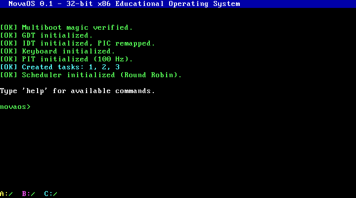
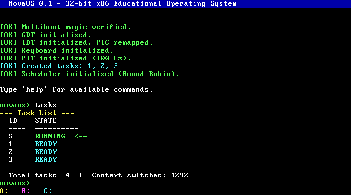
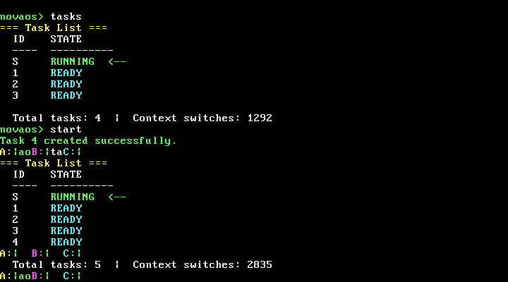
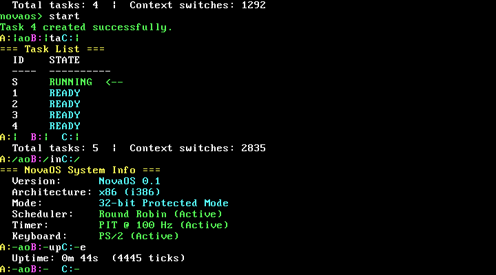

# NovaOS

**A Minimal 32-bit x86 Operating System with Interactive Shell and Preemptive Multitasking**

NovaOS is an educational operating system built from bare metal following the incremental development methodology of the "Write your own Operating System" (WYOOS) tutorial series.

---

## Live QEMU Demonstration

### 1. Boot & Subsystem Bringup
The kernel verifies the Multiboot header, sets up the GDT, remaps the dual 8259 PIC, configures the 100 Hz PIT timer, initializes the PS/2 keyboard, and launches three automatic background tasks.



### 2. Task Inspection & Real Preemptive Context Switching
The `tasks` command reads real kernel Task Control Blocks (TCBs), showing live task execution states and rapidly incrementing CPU context-switch counts.



### 3. Dynamic Task Creation & Scheduling
Typing `start` dynamically allocates and initializes a new kernel task with an isolated 4 KiB stack, which is immediately scheduled into the Round-Robin ring.



### 4. System Diagnostics & Hardware Uptime
The `info` and `uptime` commands display live system telemetry derived from actual PIT hardware ticks.



---

## Features

- **Genuine Preemptive Multitasking**: Hardware timer-driven Round-Robin CPU context switching via stack pointer exchange (`movl %eax, %esp` in `interruptstubs.s`).
- **Independent Task Stacks**: Each task executes in an isolated 4 KiB kernel stack.
- **Dynamic Task Creation**: The shell dynamically initializes new task contexts and enqueues them into the scheduler.
- **Interactive Shell**: Non-blocking keyboard buffer providing commands (`help`, `info`, `tasks`, `start`, `uptime`, `clear`).
- **Hardware Abstraction**: GDT flat model (Ring 0), dual 8259 PIC cascading, 256 IDT gates, 8254 PIT (Mode 2), 80x25 text VGA driver.

---

## Quick Start (Ubuntu 24.04 LTS / Debian)

```bash
# 1. Install toolchain dependencies & QEMU
sudo apt update
sudo apt install -y build-essential g++-multilib make grub-pc-bin grub-common \
     xorriso mtools qemu-system-x86 gdb

# 2. Build bootable ISO
make clean
make novaos.iso

# 3. Boot in QEMU
make run

# 4. Run automated test & capture screenshots
python3 scripts/qemu_test.py
```

---

## Shell Commands

| Command  | Description |
|----------|-------------|
| `help`   | Display available commands |
| `info`   | Show CPU mode, timer status, scheduler state |
| `tasks`  | Show live TCB status, active task IDs, and context-switch count |
| `start`  | Dynamically allocate and schedule a new kernel task |
| `uptime` | Display elapsed time calculated from hardware PIT ticks |
| `clear`  | Clear the VGA display terminal |

---

## Project Structure

```
src/
  loader.s           - Multiboot header, 2MB stack, entry point
  interruptstubs.s   - Low-level assembly ISR stubs (pusha/popa, iret, stack exchange)
  types.h            - Fixed-width integer definitions
  gdt.h / gdt.cpp    - Global Descriptor Table (Flat Ring 0)
  port.h / port.cpp  - Hardware port I/O hierarchy (8/16/32-bit inline asm)
  interrupts.h / cpp - 8259 PIC remapping, IDT gates, interrupt dispatcher
  keyboard.h / cpp   - PS/2 keyboard controller driver (IRQ1, circular buffer)
  timer.h / cpp      - 8254 PIT driver (IRQ0, Mode 2 Rate Generator at 100 Hz)
  multitasking.h/cpp - Task Control Block, CPUState, Round-Robin scheduler
  console.h / cpp    - 80x25 VGA driver, vertical scrolling, cursor control
  shell.h / cpp      - Interactive command parser
  kernel.cpp         - Kernel entry point, subsystem initialization, demo tasks
scripts/
  qemu_test.py       - Headless QEMU test harness with automated screendump
docs/
  screenshots/       - Captured QEMU demonstration screenshots
linker.ld            - Linker layout (kernel at 1 MiB physical)
Makefile             - Multi-target compilation and ISO generation
ACADEMIC_REPORT.md   - Full B.Tech Academic Project Report and Viva Q&A
PROGRESS_AND_TODO.md - Component verification matrix and evidence
```
